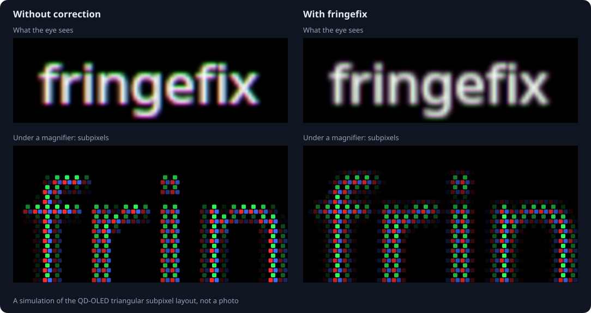
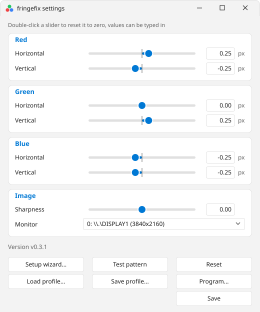
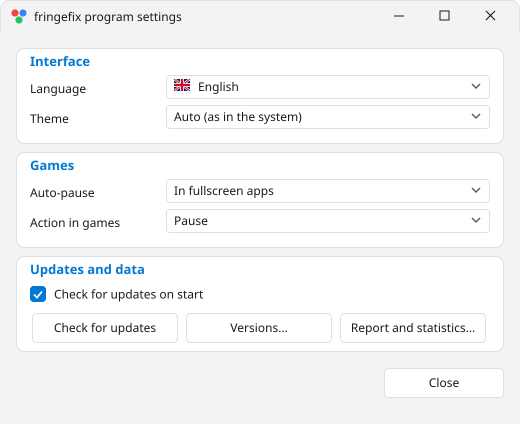
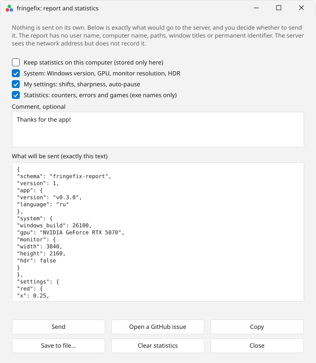
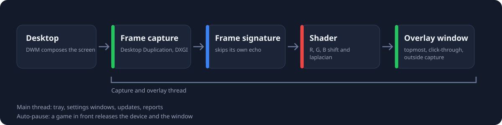

<p align="center"></p>

<p align="center"><a href="https://github.com/RuttiTuttii/fringefix/releases/latest">Download</a> · <a href="#what-the-problem-looks-like">What the problem looks like</a> · <a href="#screenshots">Screenshots</a> · <a href="#support-the-project">Support</a> · <a href="README.ru.md">Русский</a></p>

<p align="center"><a href="https://github.com/RuttiTuttii/fringefix/actions/workflows/ci.yml"></a></p>

A Windows overlay that shifts the colour channels of the finished frame by fractions of a pixel to cancel colour fringing on QD-OLED panels with the triangular subpixel layout (4th generation and earlier). Lives in the tray, tuned with sliders, updates from GitHub Releases.

> limitations: checked by hand on one configuration: RTX 4070 Ti and Gigabyte MO32U24 (31.5", 4K, 240 Hz, QD-OLED gen 3), Windows. Everything in the feature list that can be checked on it works. Not checked: AMD and Intel GPUs, other panels, several monitors with separate settings (the per-monitor threads and the window menu were written without a run on Windows, checked by compiling and under wine), several monitors on different GPUs, DRM video, update authenticity (the hash lives in the same release as the exe). Rotated monitors are not supported, the program stops with an error. The Linux part of CI only checks the portable modules and builds the exe; the overlay itself does not run on Linux. Requires Windows 10 2004 or newer. The ReShade add-on (beta) has not run with a real ReShade or inside a game. More in the "limitations and not done" section.

## what the problem looks like

on first-to-fourth generation QD-OLED the subpixels form a triangle: green above red and blue. ClearType text assumes RGB stripes, so horizontal edges get a green and a pink fringe. Fringefix shifts every channel to where its subpixel really sits.

<p align="center"></p>

## features

<table>
<tr><td width="50%" valign="top"><br><b>Channel shift</b><br>The shader moves red, green and blue by fractions of a pixel: 18 texture reads per pixel, redrawn only when the screen changes.</td><td width="50%" valign="top"><br><b>Versions and rollback</b><br>A release list, install of any version, SHA-256 check.</td></tr>
<tr><td width="50%" valign="top"><br><b>Auto-pause in games</b><br>Four modes: fullscreen apps, 3D apps, both, off. A list of programs the filter is always applied to.</td><td width="50%" valign="top"><br><b>JSON profiles</b><br>Shifts and sharpness are saved to a file and switched from the tray menu. A profile for QD-OLED gen 3 and 4 is built into the exe.</td></tr>
<tr><td width="50%" valign="top"><br><b>Privacy and reports</b><br>Statistics are local and off until you turn them on. The report is shown in full before sending and goes to the project server, through a GitHub issue or to a file.</td><td width="50%" valign="top"><br><b>Language and theme</b><br>Russian and English, light and dark theme, auto from the system or by hand.</td></tr>
</table>

## screenshots

<p align="center"><picture>
  <source media="(prefers-color-scheme: dark)" srcset="assets/screens/settings-en-dark.svg">
  
</picture></p>

<p align="center"><picture>
  <source media="(prefers-color-scheme: dark)" srcset="assets/screens/program-en-dark.svg">
  
</picture></p>

<p align="center"><picture>
  <source media="(prefers-color-scheme: dark)" srcset="assets/screens/report-en-dark.svg">
  
</picture></p>

## support the project


I make fringefix alone and it is free. If it was useful to you:

- star the repository on GitHub  it really helps: the project becomes more visible
- send any amount in crypto. Life in Russia is hard right now and even a small coin is very welcome and supports me a lot

| network | address |
| --- | --- |
| USDT on TON | `UQBHrA4BaeTkLgJ-R7KBFUJ6hoXHqCfvcmysTHboh3kxRSh4` |
| Bitcoin | `bc1qlsehpmp77xnfqmasr4tzhs3fsmtfjcwq75r2t6` |
| USDT on TRON (TRC-20) | `TB49TjDG5F9pDMiVEHAuVxdGtqmEnfEfyv` |

check the network before sending: a transfer to the wrong network cannot be recovered.

## running


- download `fringefix.exe` from the latest release and put it in any folder
- start it, a tray icon of three balls in a triangle appears (black and white means off or paused)
- double click opens settings, right click opens the menu with profiles
- the "Filter" switch at the bottom left of the settings window does the same as the toggle hotkey; with the filter off the picture is left unchanged
- `F10` toggles the overlay, `F11` quits. A global hotkey takes the key away from every program, `F11` is fullscreen in browsers: change both in the "Hotkeys" card of the program settings window or with `hotkey_toggle` and `hotkey_quit` in the ini. The format is `F1`-`F24` alone, or a letter or digit with `Ctrl`, `Alt`, `Shift`, `Win` joined by `+` (`Ctrl+Shift+F`), `none` turns a hotkey off. The Win key cannot be typed into a hotkey field of Windows, so here it is typed as text
- settings live in `%APPDATA%\fringefix\fringefix.ini`, the Save button writes them
- the "Start with Windows" checkbox in the Startup card (the "Settings" button) writes `HKCU\Software\Microsoft\Windows\CurrentVersion\Run`, no administrator rights needed. The state is read from the registry: if the exe moved to another folder the checkbox is off, turning it on again updates the path

## tuning


1. press the test pattern button: the pattern window opens to the right of the settings window, keep the settings window on the monitor the overlay corrects. The button and a click on the pattern close it
2. move the vertical green slider until horizontal edges turn grey
3. move the horizontal red and blue sliders in opposite directions until vertical edges turn grey
4. the other shifts are usually unneeded on this panel: red and blue subpixels sit at the same height and green sits midway between them horizontally
5. press save

The window is split into cards: the Image card on top has the monitor choice, the filter switch of that monitor and sharpness, below it one card each for red, green and blue with a horizontal and a vertical shift. Everything is at zero until you change it.

**several monitors.** Everything below the monitor list belongs to the monitor chosen in it: shifts, sharpness, the filter switch, the "Save profile..." and "Reset" buttons. The program drives all monitors at once, one capture thread each; every monitor has its own auto-pause (a fullscreen game on one does not switch the filter off on another). The master switch (`F10`, the tray item, the add-on slider) acts on top: a monitor works when both its own switch and the master switch are on. The settings in `fringefix.ini` lie in `mon0_`, `mon1_` and so on blocks by output number, `monitor` keeps the monitor shown in the window; a file of the old form (one set of shifts without a number) is read as the settings of the monitor the overlay ran on. Without settings the filter is on only for monitor 0. A profile holds the shifts and sharpness of the selected monitor. If the overlay of a monitor fails to start it stays silent until you switch the filter on again, and the switch in the settings stays as it was.

**window menu.** The menu bar "File", "Edit", "Tools", "Help" repeats the buttons and adds opening the profiles folder, the master switch, "What's new..." (the change list is embedded in the exe, `CHANGELOG.md` and `CHANGELOG.ru.md`) and "About...". Shortcuts: `Ctrl+O` load a profile, `Ctrl+S` save a profile, `F1` about. The menu is drawn in the palette of the window instead of the system menu so that it does not stay light in the dark theme.

The test pattern is as tall as the settings window and half as wide. The top half is light (black on white), the bottom half is dark (white on black). Each half has three bands: thin lines (1 pixel, 14 pixel pitch), thick lines (5 pixels, 10 pixel pitch) and the alphabet, lowercase letters first, then capitals. In the first two bands horizontal lines are on the left and vertical lines on the right. Line thickness is in physical pixels and does not follow Windows scaling: a one pixel line is the subpixel probe. The pitch is given for 100% and grows with the scaling of the settings window (at 150% a pitch of 14 becomes 21). The pattern moves with the settings window.

- a positive value moves the channel content right and down, range is -2 to 2 pixels, step 0.01
- a value can be typed into the field right of the slider, dot and comma both work, the change applies at once
- a double click on a slider resets it to zero, the mouse wheel moves it by 0.01 (0.1 with Shift), arrows by 0.01, PageUp and PageDown by 0.1, Home and End to the ends
- sharpness is from -1 to 1: plus strengthens contours, minus softens them

A sub-pixel shift goes through bilinear interpolation, which blurs. The shader restores sharpness up front with a laplacian of strength `min(1.72 * f^2, 0.35)`, where `f` is the fractional part of the shift. So with non-zero shifts a small contour boost exists even at sharpness 0, and with zero shifts there is none. Sharpness -1 cancels the maximum of that boost completely.

## auto-pause


the mode is chosen in the Auto-pause rules card of the program settings window (the "Settings" button), the `auto_pause` key in the ini:

- 0 off
- 1 in fullscreen apps (default)
- 2 in fullscreen and 3D apps
- 3 in 3D apps only

the list shows the modes in this order: fullscreen and 3D, fullscreen, 3D, off. Mode 2 is the default.

a fullscreen app is an active window with no title bar or frame that covers the whole overlay monitor (2 pixel slack): a borderless game, exclusive fullscreen, F11 video in a browser. A 3D app is the active window's process that loaded d3d9, d3d11, d3d12, vulkan-1 or opengl32 and is not in the built-in list of known non-games (browsers, editors, messengers, office, the shell). Windows built on the Chromium engine (Electron, CEF) are never counted as 3D apps: they load d3d11 for compositing but are not games. A process protected from reading (anti-cheat) is detected by fullscreen only, so in mode 3 it is not detected at all.

- the check runs every 0.5 seconds, the pause is lifted after two consecutive checks without a game so alt-tab back and forth does not recreate the device
- while paused the D3D device and the overlay window are released and the tray icon is grey
- why: an overlay over a fullscreen game takes away its direct output that bypasses DWM composition (independent flip, per the documentation), adds a frame of latency and loads the GPU itself

## latency


- the device frame queue is limited to one frame instead of the default three
- the rest of the latency is built into the scheme: the desktop is captured after DWM composition, the overlay is drawn and composed again, at least one or two frames. For games the answer is auto-pause
- I did not measure values in milliseconds

## auto-pause rules


the Auto-pause card of the program settings window has two items:

- "Auto-pause": when to consider a game running (fullscreen and 3D, fullscreen, 3D, off). In a game the overlay pauses: it releases the device and the window, the light mode is gone
- "Action in games": it can be changed only while auto-pause is off, in any other mode it shows a locked "Pause". "Pause" releases the device and the overlay window, "Light mode" keeps the overlay but the shader does one shift per channel without the laplacian and sharpness and costs almost nothing. Light mode does not remove DWM composition, so only a pause lifts the game latency. With auto-pause off and light mode, games are looked for as in the "fullscreen and 3D apps" mode and light mode is used instead of a pause; with auto-pause off and "Pause" nothing is looked for
- "App filter...": a window with two lists, "Always apply the filter" (`ignore_apps`: photo viewers, players, whatever auto-pause is set to) and "Always pause" (`pause_apps`). The "+ Add..." button opens a picker with the running programs that have a visible window; the search box filters by process name or by window title. An app that is not running can be typed in by hand: when no row matches, the typed name is added. "− Remove" deletes the selected row. An app is in one list at a time: adding it to one list removes it from the other. The name must be Latin, each list takes up to 1023 bytes

more in `fringefix.ini`:

- `pause_apps = game.exe;other.exe` always treat as a game even when the window is not fullscreen; a name without `.exe` also fits, case is ignored
- `ignore_apps = player.exe` never treat as a game, for example a fullscreen video player
- `gpu_priority = -3` GPU priority of the overlay thread from -7 to 7; below zero the overlay yields the GPU to the game

## versions and rollback


the "Versions..." button in the program settings window opens a list of the repository releases (up to the latest 30 that have `fringefix.exe` and `fringefix.exe.sha256`). Picking a version newer than the current one installs an update, older installs a rollback. Versions are not compared during installation: the hash check and the exe swap are the same as in a normal update, settings in `%APPDATA%` stay. Betas are hidden in the list until the "Get beta versions" checkbox is on. Old releases are not overwritten: to go back to a version it must stay in Releases.

## profiles


- "Save profile..." and "Load profile..." work with JSON files, the default folder is `%APPDATA%\fringefix\profiles`
- the tray menu item "Profiles" lists the files from that folder, picking one applies it at once
- a profile holds only the look of the picture of the selected monitor: the three channel shifts and sharpness; the monitor switch, the monitor number and the update check stay as they were. "Load profile..." and "Save profile..." always open in the profiles folder of the program
- the bundled profile "QD-OLED gen 3 4" is built into the exe and put into the profiles folder at start if that file is not there: an edited file is not overwritten, a deleted one comes back at the next start. The files live in `profiles/`, a new profile is a line in `src/res/fringefix.rc`, a number in `include/resource.h` and an entry in the `BUNDLED` table in `src/profile_io.c`

```json
{
  "format": "fringefix-profile",
  "version": 1,
  "red": { "x": 0.000, "y": 0.000 },
  "green": { "x": 0.000, "y": 0.250 },
  "blue": { "x": -0.150, "y": 0.000 },
  "sharpen": 0.000
}
```

Out-of-range values are clamped, broken ones are skipped, a file without the `format` field is rejected whole.

## language, theme and icons


- "Settings" in the settings window opens the program settings window: language, theme, auto-pause, updates, start with Windows
- language: "Auto" follows the Windows display language: Russian only on a Russian Windows, English on any other, European languages included, "Русский" and "English" are picked by hand; every list item has a flag
- theme: "Auto" follows the Windows "app mode" setting, "Light" and "Dark" are set by hand; a change applies to open windows at once
- a language change recreates the windows, settings are kept
- the slider accent colour comes from the system one
- the application icon: three balls in a triangle, red and blue on top, green below, as in a macro photo of QD-OLED subpixels. The drawings live in `assets/` as SVG: `icon.svg` with a tile that turns light in the light theme, `mark.svg` without a tile for small sizes, and the flags in `assets/flags/`. The drawing is flat, with no gradients or glow
- the icon of a disabled overlay is the same drawing under a monochrome filter
- the exe ICO files are built from the SVG with `make icons` (needs `rsvg-convert`), the ready ones are in `src/res/`

## statistics and reports


everything below is off until you turn it on yourself. Nothing is sent on its own.

- in the program settings window the "Report and statistics..." button opens the report window
- the "Keep statistics on this computer" checkbox turns on local counters: frames, skipped echo frames, device recreations, pauses, overlay errors and the games that caused a pause. The `stats.txt` file sits next to the settings in `%APPDATA%\fringefix` and goes nowhere
- the window shows exactly the JSON text that would go over the network; you can untick the System, Settings and Statistics sections and add a comment
- there are three ways to send: to the project server with the Send button (with a confirmation), through a new GitHub issue (the report is copied to the clipboard and you paste it into the issue yourself), or just save it to a file
- "Clear statistics" resets the counters and deletes the file

what the report holds: the program version and language; the Windows build number, the GPU name, the monitor resolution and an HDR flag; channel shifts and sharpness of the selected monitor, auto-pause mode and GPU priority; counters; overlay error texts; for games only the exe name without a path, how it was detected, what the overlay did, the number of sessions and minutes; your comment.

what the report does not hold: user name, computer name, file paths, window titles, monitor serial numbers, a permanent identifier and the send time.

the receiver on the server checks the report against a whitelist of fields, limits the size and the rate (5 per hour per address), stores each report as its own file with mode 0600 and records the client address nowhere: the rate limit keeps only a salt and a hash in memory. The receiver code and instructions are in `server/`. The receiving address goes into the exe at build time from the `REPORT_URL` variable and is not in the sources; if it is not set, the Send button is disabled and the other ways keep working. The server still sees the network address at the moment of the request, which is a property of any network connection.

## ReShade add-on (beta)

> beta: the dll is built by mingw-w64 and has not started with a real ReShade or inside a game. Checked: the effect compiles with the real `d3dcompiler_47` (under wine, 8-bit and FP16 variants), the value exchange between the app and a second process and the add-on marker work under wine, `ReShade.ini` parsing is covered by a test. Not checked: loading of the dll by a real ReShade (which is built with MSVC), GPU timestamps in D3D11, D3D12, Vulkan and OpenGL, the tab in the ReShade overlay.

The add-on draws the same filter as engine 2, but inside the game's frame: no desktop capture, no frame comparison and no overlay window. What moves over from the app is `kernel.c` (the 3x3 window weights per channel are computed on the CPU) and the `psk` shader rewritten in the ReShade effect language (`addon/fringefix.fx`). Two files: `fringefix.addon64` (a C++17 dll, about 290 KB) and `fringefix.fx`. Both are embedded in the exe.

**install.** The program "Settings" window, the "ReShade integration" card (highlighted with colour), the "Install the add-on..." button, pick the game exe:

- the add-on is copied next to the game's `ReShade.ini` (or into `AddonPath` from its `[ADDON]` section)
- the effect is copied into the first folder of `EffectSearchPaths` in `[GENERAL]`, `reshade-shaders\Shaders` by default
- ReShade itself is not installed or downloaded; if it is not visible in the folder (no `ReShade.ini` and no proxy dll larger than a megabyte) the program asks whether to copy the files anyway
- a running game holds the dll, so the replace fails: close the game first
- "Remove from a game..." deletes both files. After updating the app, install the add-on again: its version is embedded in the exe

Requires ReShade 6.8.0 or newer built with full add-on support: the regular ("limited") build skips `*.addon64`. The version is tied to ReShade because the add-on asks it for the Dear ImGui 1.92.5 (19250) function table and ReShade 6.8.0 offers no other. 64-bit games only. The effect is on by default (the `enabled` annotation); put it last in the technique list: the fringe is computed from the final picture.

**where the settings come from.** The order is below, the fringefix tab in the ReShade overlay names the source in use:

| source | when | what it is |
| --- | --- | --- |
| the app, live values | the app is running | what the sliders show right now, before "Save"; the filter switch too. Named shared memory `Local\fringefix_live_v1`, the add-on reads it every 0.5 seconds |
| `fringefix.ini` | the app is closed | what was last saved in `%APPDATA%\fringefix`; re-read when its write time changes |
| own values | the "Follow the fringefix app" box is off or there is no ini | six shifts and sharpness from the tab, kept in the game's `ReShade.ini`, section `[FRINGEFIX]` |

**overlay pause.** While the effect is loaded and enabled in ReShade, the add-on holds a named mutex `Local\fringefix_addon_<pid>` in the game process. Every 0.5 seconds the app checks the process of the active window, and if the window lies on the overlay monitor and the mutex exists, the overlay pauses in any auto-pause mode; the "never pause" lists do not apply in that case, otherwise the shift would be applied twice. The tray tip reads "paused, the ReShade add-on is running in the game". A report marks such a session `how = addon`.

**the fringefix tab in the ReShade overlay.** The source, the checkbox, six shift sliders and sharpness (editable only on own values), measurements in the spirit of the diagnostics window. Measurements run only while the tab is open:

- GPU time of the effect pass: timestamps between the end of the previous ReShade technique and the end of ours, including the frame copy ReShade makes for each technique
- CPU time of all ReShade effects per frame, frame interval and frame rate
- GPU power, load and clock through `nvml.dll`, NVIDIA only
- three graphs over the last 240 frames and a summary of mean, p95 and maximum

Add-on limitations:

- works only in games with ReShade: the desktop, browsers and other windows without it stay on the overlay
- ReShade in games with anti-cheat (EAC, BattlEye and similar) can get an account banned; the app's overlay does not carry that risk
- a game without the add-on follows the auto-pause rules as before; the add-on affects only the process it is loaded into
- ReShade may write the effect's service uniforms into the preset; the add-on pushes its own values again every time a preset or the effects are loaded

## diagnostics and engines (beta)

> beta: engines 1 and 2 and the diagnostics window were written without running on a real GPU. The shaders compile with the real `d3dcompiler_47`, the 3x3 kernel math is checked against the classic shader formulas by a test over 400 shift sets, and on D3D11 under wine (software GL) the kernel shader differs from the classic one by at most 0.003 while the compute comparison flags match the pixel one block for block. The first run shows time and power on real hardware.

The "Diagnostics and measurements..." button in the "Updates and data" card of the program settings window opens a window with the choice of engine, frame output and GPU priority, a run and a results table; the measurements and the panel belong to the monitor chosen in the main window. Graphs and counters are shown by a panel over the overlay (below). The `engine` ini key stores the chosen engine (0, 1 or 2), 2 by default; engine 2 is labelled "(default)" in the list.

| engine | frame comparison | filter |
| --- | --- | --- |
| 0, classic | pixel shader, 32,400 threads of 256 pixels each in sequence | 18 texture reads per pixel |
| 1, compute comparison | compute shader, a 16 by 16 thread group per block, 8.3 million threads | same as 0 |
| 2, compute and 3x3 kernel | same as 1 | one 3x3 window per channel, weights computed on the CPU; 9 reads per pixel when the shift spread between channels is under one pixel on each axis, otherwise 27 |

The picture is the same for all three. Engine 2 differs from the classic one only in that bilinear weights are exact rather than the 8-bit hardware ones, so values can differ by a fraction of the lowest bit. If the compute shader or the kernel shader fails to create on the GPU, the diagnostics window states the reason and the overlay runs on the engine below. On a monitor where the channel shifts differ by more than a pixel on any axis the kernel reads 27 pixels instead of 9, and engine 1 runs instead of engine 2; the diagnostics window and the panel show the engine in effect and the reason.

What is measured while the window is open:

- GPU stage times with D3D11 timers: frame copy, comparison, shader. The timers sit at command boundaries, so they include gaps between commands
- CPU time of a cycle from receiving the frame to the `Present` call, the duration of `Present` itself (it waits for vertical sync), the frame's age at DWM when received, and the gap between consecutive draws
- GPU power, load and clock through `nvml.dll` from the NVIDIA driver, refreshed about four times a second; on AMD and Intel these fields are empty. The program's CPU load is always counted
- key-to-pixel latency is not measured: it needs an external instrument

"Stress mode" draws every received frame, not only a changed one. Every draw makes DWM send a new frame, and the cycle runs at the monitor refresh rate, as with a constantly changing screen.

"Run all engines" goes in order: 4 seconds of warm-up and 12 seconds of measurement with the filter off (base power), then 3 seconds of warm-up and 12 seconds of measurement for engines 0, 1 and 2 in stress mode. The results table shows per engine: cycles per second, GPU time (mean and p95), CPU time, `Present`, draw interval, watts, watts over the filter-off row, GPU load and clock. Close games and video during the run: auto-pause is not disabled. If the window is closed mid-run, the engine and the filter return to what they were and nothing is written to the ini.

"Save CSV..." writes the run results (or a summary of the last seconds if there was no run) and, after a `# samples` line, the raw data of the last 4096 cycles.

**Panel over the overlay.** While the diagnostics window is open and the "Measurement panel over the overlay" box is ticked (on by default), a panel sits in a corner of the overlay monitor (chosen with the "Panel position" list of the diagnostics window, the `hud_corner` ini key: 0 top left, 1 top right, 2 bottom left, 3 bottom right, so that it does not collide with the MSI Afterburner counter): a header with the active engine, output mode and priority, a line of frame counters, stage times, latencies and three graphs (GPU stages, latencies, power). It is a separate window: it is excluded from capture (`WDA_EXCLUDEFROMCAPTURE`), so the filter does not distort it and it does not cause echo frames, it lets the mouse through, takes no focus and is raised above the overlay together with it every two seconds. The panel does not exist while the overlay does not run: paused, filter off, after an error. If the system does not accept `WDA_EXCLUDEFROMCAPTURE`, the panel is not created at all and the overlay works as usual. Updating the panel four times a second may wake DWM, which adds a few cycles per second to the measurements.

The counters in the `per s` line:

- `dwm` desktop updates DWM delivered (the sum of `AccumulatedFrames`; it includes updates caused by the overlay's own window)
- `got` frames the program managed to receive and copy
- `drawn` how many of them were drawn
- `merged` the share of merged ones, `(dwm - got) / dwm`; the line turns red above 25%. A merged frame is several desktop updates that DWM handed over as one because the cycle did not take them one by one: this is how game frames get lost with the filter on
- `echo` how many frames were judged an echo of the overlay's own window

The CSV carries the same numbers: an `accum` column in the raw frames, `source_per_s` and `merged_pct` in the results, and a `merged%` column in the window's results table.

**Frame output and GPU priority (beta).** Two lists sit next to the engine choice:

- "Frame output": 0 waits for vsync (`Present(1, 0)`, as before), 1 does not wait (`Present(0, ALLOW_TEARING)`, the swap chain is created with the tearing flag). The `present_mode` ini key. If the system does not support tearing, vsync stays and the window shows "requested 1, active 0". Changing the output mode recreates the swap chain and the overlay window
- "GPU priority": -7, -3, 0, +3, +7, the `gpu_priority` ini key. It applies on the live device and the window reads back what was accepted: the system may refuse a priority above zero without privileges

**Rollback in 10 seconds.** Any change of engine, output or priority is a trial: it is not written to the ini, a strip with "Keep" and "Revert" buttons and a countdown appears under the hint, and the panel shows a red "Trial: reverting in N s" line. "Keep" writes the value to the ini. If nothing is pressed, everything returns after 10 seconds and the ini is rewritten with the previous values. The rollback is immediate, without the timer, if the overlay failed to start (the device failure counter grows) and if the diagnostics window is closed. While a trial runs, the all-engines run cannot start. The timer lives in the diagnostics window, so a lost picture reverts by itself and nothing needs to be pressed. If the process dies during a trial, the ini still holds the previous values. Exception: another program window that saves settings during the trial writes the trial values to the ini too, and the rollback then rewrites the file back.

Checked under wine: the panel drawing at 96 and 192 dpi, creating and closing the panel window, the trial countdown and rollback, the ini after a rollback and after "Keep"; wine does not accept `WDA_EXCLUDEFROMCAPTURE`, so the panel window was looked at with that check disabled in a copy of the code. Not checked: the panel over the real overlay and a game, tearing output on a real GPU, a GPU priority above zero, the merged frame count in a game.

Measurement limits: the ring keeps the last 4096 cycles, about 17 seconds at 240 Hz; GPU timers run only while the window is open; NVML power is averaged by the driver and refreshes no more than once per 100 ms.

## how it works

<p align="center"></p>


```
main.c ─ ui_tray.c ─ ui_settings.c ─ ui_controls.c, ui_paint.c, slider.c, theme.c
  │         │            └─ ui_profile.c, pattern.c
  │         │            └─ ui_bench.c ─ bench.c, power.c, benchstat.c, trial.c
  │         │            └─ ui_versions.c, ui_app.c, ui_prefs.c, autostart.c
  │         │            └─ ui_reshade.c ─ reshade_inst.c, rspaths.c
  │         │            └─ ui_report.c ─ report_actions.c, report_send.c, report.c
  │         └─ ui_update.c ─ update.c, update_install.c ─ http.c, sha256.c, release.c
  └─ app.c ─ config.c, profile.c, profile_io.c, i18n.c, stats.c, stats_store.c, live.c
       └─ capture.c (own thread) ─ gamedetect.c ─ applist.c, hud.c
            └─ gfx.c, gfx_frame.c, gfx_sig.c, gfx_prof.c ─ shader.c, kernel.c, output.c

add-on (own dll, src/ is shared):  addon/addon.cpp ─ fringefix.fx, kernel.c, config.c, live.c, power.c, benchstat.c
```

- the frame comes from `IDXGIOutput6::DuplicateOutput1`, format follows the desktop mode: 8-bit in SDR, FP16 scRGB in HDR
- the window uses `WDA_EXCLUDEFROMCAPTURE`, so it does not appear in the desktop snapshot
- capture and overlay run in their own thread: menus, dialogs and window dragging do not freeze the picture
- the overlay still wakes capture: per comments in the original's source, DWM recomposes the desktop after every `Present`. Without a guard each draw would trigger the next one at full refresh rate
- so each frame is classified first: cursor-only is skipped, scrolls and small areas (under 1/50 of the screen) are drawn at once, anything else is compared with the previous frame on the GPU: the screen is split into 16 by 16 pixel blocks, a shader compares the red, green and blue channels of both frames bit by bit, the CPU reads one flag per block (129,600 bytes at 4K) and skips the frame if nothing differs
- every 2 seconds the window is put back on top of the z-order
- each channel costs one hardware bilinear read plus 5 laplacian reads, 18 reads per pixel; at 4K 240 Hz that is about 36 billion reads per second (calculated, not measured)
- the filter is global: every pixel of the screen goes through the shader with the same shifts, there is no mask
- the per-stage breakdown (frame copy, comparison, shader, echo), a GPU load estimate and a list of possible optimizations are in [docs/performance.ru.md](docs/performance.ru.md) (Russian only); I did not measure the stage times

## updates


- on start the program queries `api.github.com/repos/<repo>/releases/latest` and compares the `vX.Y.Z` tag with the build version
- if newer, it asks for permission, downloads `fringefix.exe` and `fringefix.exe.sha256` from the same release and checks SHA-256
- only links of the form `https://github.com/<repo>/releases/download/` are accepted, others are dropped
- the old exe is renamed to `fringefix.exe.old`, the new one takes its place, the program restarts
- the startup check is turned off by the checkbox in settings or `check_updates = 0` in the ini
- the "Get beta versions" checkbox (`beta = 1` in the ini) makes the check take the newest release by number from the whole list, betas included. A beta is a release with a tag `vX.Y.Z-beta.N` marked as a pre-release on GitHub: `releases/latest` never returns it, so users without the checkbox are not offered betas. `v0.5.0-beta.2` is newer than `v0.5.0-beta.1` and older than `v0.5.0`. The version list shows betas only with the checkbox on. If a beta is installed and the checkbox is turned off, the check offers the newest stable release instead, even if it is older by number (a rollback). The windows that were open (settings, program, app lists) reopen at the same places after an update or rollback restart
- a non-tag build (`dev`) does not check for updates

Protection of the update itself is limited to TLS to github.com and a hash match against a file from the same release. If the account or the release is compromised, the hash is forged together with the exe. The updater does not check the Authenticode signature.

Signing of releases:

- CI signs `fringefix.exe` and the embedded `fringefix.addon64` with Authenticode (`tools/sign.ps1`, signtool from the Windows SDK, SHA-256, RFC 3161 timestamp). The certificate is a repository secret: `SIGN_PFX_BASE64` (a base64 pfx) and `SIGN_PFX_PASSWORD`. The hash file is computed after signing
- a stable tag build fails if the secret is missing, so an unsigned stable release cannot go out; `-beta.N` tags and other runs only print a warning, so betas go out unsigned for now
- a tag build also publishes a signed build provenance attestation (sigstore). Check a downloaded file with `gh attestation verify fringefix.exe --repo OWNER/fringefix`
- a signature from a new certificate does not remove SmartScreen warnings at once: reputation builds up with downloads, unless the certificate is EV


## build and release


```bash
# tests for config, versions, release links and SHA-256, run on any system
make test
```

```bash
# the same tests under ASan and UBSan, warnings as errors; CC=clang works too
make test SAN=1 WERROR=1
```

```bash
# Windows build with the mingw-w64 cross compiler (gcc and g++: the ReShade add-on is C++ and is embedded in the exe), REPO enables update checks
make win REPO=owner/fringefix
```

```bash
# native build in msys2 UCRT64
make win CC_WIN=gcc CXX_WIN=g++ WINDRES=windres REPO=owner/fringefix
```

```bash
# release: a vX.Y.Z tag runs the GitHub Actions build and publishes the exe with its sha256 file
git tag v0.1.0 && git push origin v0.1.0
```

## CI on GitHub Actions


- `linux`: tests of the portable modules on Ubuntu with two compilers (gcc and clang) under ASan and UBSan, warnings as errors
- `cross`: a full exe build with the mingw-w64 cross compiler on Ubuntu, warnings as errors, the imported DLL list in the log, the exe in artifacts
- `build`: the release build in msys2 UCRT64 on a Windows runner
- `server`: tests and ruff for the report receiver in Python
- `release`: on a `vX.Y.Z` tag, only if all four previous jobs are green

the application runs on Windows only: capture through DXGI Desktop Duplication and output through Direct3D 11 do not port to Linux. On Linux the CI checks the code and builds the exe but does not run it.

## limitations and not done


- automatic fringing measurement, for example from a photo of the screen: the shifts are tuned by hand with the test pattern
- layouts other than the QD-OLED triangle: WOLED, for example, arranges subpixels differently
- text-only mask for sharpening: shift and sharpening apply to the whole screen, photos and video are processed like text
- rotated monitors
- Authenticode signing of releases works only once the certificate is in the repository secrets (see the updates section); until then betas go out unsigned and a stable tag build fails
- a Linux version: planned (a GNOME Shell extension, a KWin effect or a Hyprland shader), capture through DXGI does not port to Linux
- languages other than Russian and English
- the overlay adds at least one frame of latency over the desktop, I did not measure it in milliseconds
- the overlay turns off a game's independent flip path around DWM, which is why auto-pause exists
- the ReShade add-on: checked up to loading (build, shader compile, value exchange under wine), it has not run in a game; 32-bit games are not supported; in games with anti-cheat ReShade can get an account banned

[GPL-3.0](LICENSE)
