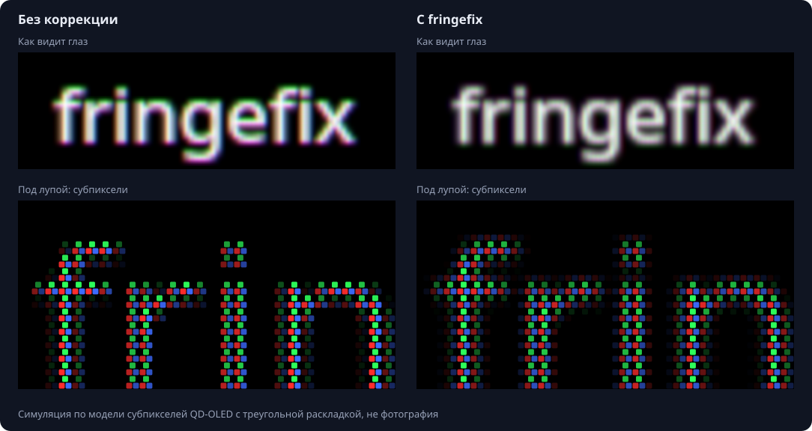
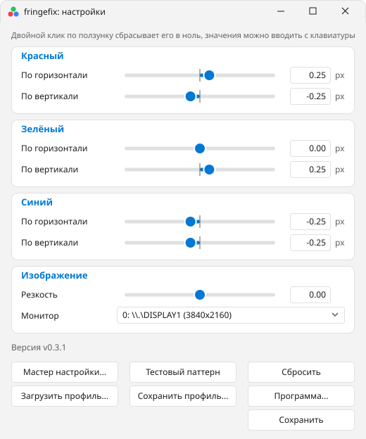
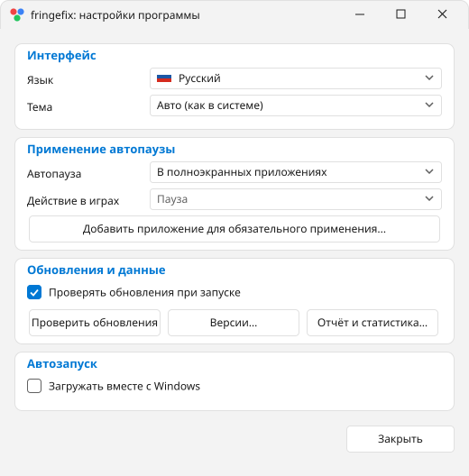
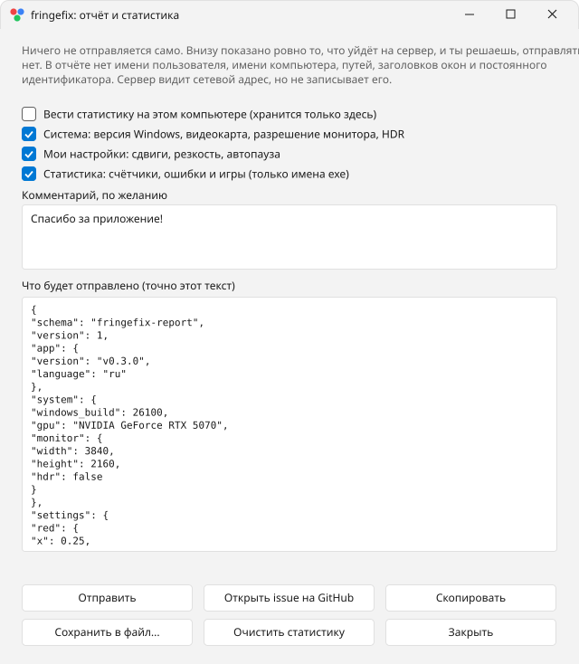
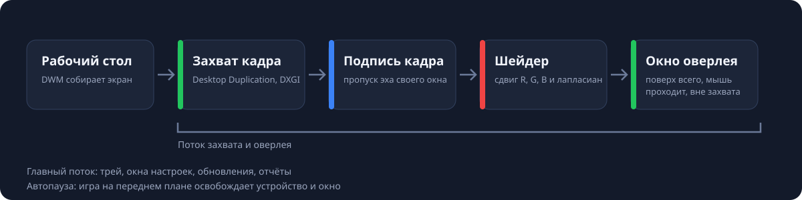

<p align="center"></p>

<p align="center"><a href="https://github.com/RuttiTuttii/fringefix/releases/latest">Скачать</a> · <a href="#как-выглядит-проблема">Как выглядит проблема</a> · <a href="#скриншоты">Скриншоты</a> · <a href="#поддержать-проект">Поддержать</a> · <a href="README.md">English</a></p>

<p align="center"><a href="https://github.com/RuttiTuttii/fringefix/actions/workflows/ci.yml"></a></p>

оверлей для Windows, который сдвигает цветовые каналы готового кадра на доли пикселя и гасит цветную каёмку на тексте QD-OLED с треугольными сабпикселями (до 4 поколения включительно). Живёт в трее, настраивается ползунками, обновляется из GitHub Releases.

> ограничения: проверено вручную на одной конфигурации: RTX 4070 Ti и Gigabyte MO32U24 (31,5", 4K, 240 Гц, QD-OLED 3 поколения), Windows. Всё из списка возможностей, что на ней можно проверить, работает. Не проверялось: видеокарты AMD и Intel, другие панели, несколько мониторов на разных видеокартах, DRM-видео, подлинность обновлений (хеш лежит в том же релизе, что и exe). Повёрнутые мониторы не поддерживаются, программа останавливается с ошибкой. Линуксовая часть CI проверяет только портативные модули и сборку exe; сам оверлей на Linux не запускается. Нужна Windows 10 2004 или новее. ReShade-аддон (бета) не запускался ни с настоящим ReShade, ни в игре. Подробнее в разделе «ограничения и что не сделано».

## как выглядит проблема

у QD-OLED первых четырёх поколений субпиксели стоят треугольником: зелёный над красным и синим. Текст из ClearType рассчитан на полоски RGB, поэтому у горизонтальных краёв появляется зелёная и розовая каёмка. Fringefix сдвигает каждый канал туда, где его субпиксель стоит на самом деле.

<p align="center"></p>

## возможности

<table>
<tr><td width="50%" valign="top"><br><b>Сдвиг каналов</b><br>Шейдер сдвигает красный, зелёный и синий на доли пикселя: 18 чтений текстуры на пиксель, перерисовка только когда меняется экран.</td><td width="50%" valign="top"><br><b>Версии и откат</b><br>Список релизов, установка любой версии, сверка SHA-256.</td></tr>
<tr><td width="50%" valign="top"><br><b>Автопауза в играх</b><br>Четыре режима: полноэкранные приложения, 3D-приложения, оба, выключена. Список программ, к которым фильтр применяется всегда.</td><td width="50%" valign="top"><br><b>Профили JSON</b><br>Сдвиги и резкость сохраняются в файл и переключаются из меню трея. Профиль для QD-OLED 3 и 4 поколения вшит в exe.</td></tr>
<tr><td width="50%" valign="top"><br><b>Приватность и отчёты</b><br>Статистика локальная и выключена, пока не включишь. Отчёт виден целиком до отправки и уходит на сервер проекта, через issue на GitHub или в файл.</td><td width="50%" valign="top"><br><b>Язык и тема</b><br>Русский и English, светлая и тёмная тема, авто по системе или вручную.</td></tr>
</table>

## скриншоты

<p align="center"><picture>
  <source media="(prefers-color-scheme: dark)" srcset="assets/screens/settings-ru-dark.svg">
  
</picture></p>

<p align="center"><picture>
  <source media="(prefers-color-scheme: dark)" srcset="assets/screens/program-ru-dark.svg">
  
</picture></p>

<p align="center"><picture>
  <source media="(prefers-color-scheme: dark)" srcset="assets/screens/report-ru-dark.svg">
  
</picture></p>

## поддержать проект


fringefix делаю я один, он бесплатный. Если он тебе пригодился:

- поставь звезду репозиторию на GitHub  это правда помогает: проект становится заметнее
- отправь любую сумму криптой. В России сейчас тяжело, и даже копейка очень кстати и сильно поддерживает меня

| сеть | адрес |
| --- | --- |
| USDT в сети TON | `UQBHrA4BaeTkLgJ-R7KBFUJ6hoXHqCfvcmysTHboh3kxRSh4` |
| Bitcoin | `bc1qlsehpmp77xnfqmasr4tzhs3fsmtfjcwq75r2t6` |
| USDT в сети TRON (TRC-20) | `TB49TjDG5F9pDMiVEHAuVxdGtqmEnfEfyv` |

перед переводом сверь сеть: перевод в неверную сеть не вернуть.

## запуск


- скачай `fringefix.exe` из последнего релиза и положи в любую папку
- запусти, в трее появится значок из трёх шариков треугольником (чёрно-белый значит выключен или идёт пауза)
- двойной клик по значку открывает настройки, правый клик открывает меню с профилями
- выключатель «Фильтр» слева внизу в окне настроек делает то же, что сочетание включения; выключенный фильтр ничего не меняет в картинке
- `F10` включает и выключает оверлей, `F11` закрывает программу. Глобальное сочетание забирает клавишу у всех программ, а `F11` это полноэкранный режим в браузерах: поменяй оба в карточке «Сочетания клавиш» окна настроек программы или ключами `hotkey_toggle` и `hotkey_quit` в ini. Формат: `F1`-`F24` отдельно или буква и цифра с `Ctrl`, `Alt`, `Shift`, `Win` через `+` (`Ctrl+Shift+F`), `none` выключает сочетание. Клавишу Win в стандартное поле Windows не ввести, поэтому сочетание вводится текстом
- настройки лежат в `%APPDATA%\fringefix\fringefix.ini`, окно настроек их записывает кнопкой «Сохранить»
- галочка «Загружать вместе с Windows» в карточке «Автозапуск» (кнопка «Настройки») пишет `HKCU\Software\Microsoft\Windows\CurrentVersion\Run`, права администратора не нужны. Состояние читается из реестра: если exe переехал в другую папку, галочка снята, повторное включение обновит путь

## настройка


1. нажми «Тестовый паттерн»: справа от окна настроек откроется окно паттерна, держи окно настроек на том мониторе, который корректирует оверлей. Кнопка и клик по паттерну закрывают его
2. двигай «Зелёный, по вертикали», пока горизонтальные края не станут серыми
3. двигай «Красный, по горизонтали» и «Синий, по горизонтали» в противоположные стороны, пока серыми не станут вертикальные края
4. остальные сдвиги на этой панели обычно не нужны: красный и синий субпиксели стоят на одной высоте, зелёный по горизонтали лежит посередине между ними
5. нажми «Сохранить»

окно разбито на карточки по цветам: у красного, зелёного и синего канала есть сдвиг по горизонтали и по вертикали, в карточке «Изображение» резкость и выбор монитора. Всё стоит в нуле, пока ты ничего не менял.

тестовый паттерн той же высоты, что окно настроек, и вдвое уже. Верхняя половина светлая (чёрное на белом), нижняя тёмная (белое на чёрном). Каждая половина делится на три полосы: тонкие линии (1 пиксель, шаг 14 пикселей), толстые линии (5 пикселей, шаг 10 пикселей) и алфавит, строчные буквы, затем заглавные. В первых двух полосах слева горизонтальные линии, справа вертикальные. Толщина линий задана в физических пикселях и от масштаба Windows не зависит: тонкая линия в один пиксель это проба субпикселей. Шаг указан для 100% и растёт вместе с масштабом окна настроек (при 150% шаг 14 становится 21). Паттерн ходит за окном настроек.

- плюс сдвигает содержимое канала вправо и вниз, диапазон от -2 до 2 пикселей, шаг 0.01
- значение можно ввести с клавиатуры в поле справа от ползунка, точка и запятая подходят, изменение применяется сразу
- двойной клик по ползунку сбрасывает его в ноль, колесо мыши двигает на 0.01 (с Shift на 0.1), стрелки на 0.01, PageUp и PageDown на 0.1, Home и End в края
- резкость от -1 до 1: плюс усиливает контур, минус смягчает

сдвиг на долю пикселя идёт через билинейную интерполяцию, и она размывает. Шейдер заранее возвращает чёткость лапласианом, сила `min(1.72 * f², 0.35)`, где `f` это дробная часть сдвига. Поэтому при ненулевых сдвигах небольшое усиление контура есть даже при резкости 0, при нулевых сдвигах его нет. Резкость -1 полностью гасит максимум этой добавки.

## автопауза


режим выбирается в карточке «Применение автопаузы» окна настроек программы (кнопка «Настройки»), ключ `auto_pause` в ini:

- 0 выключена
- 1 в полноэкранных приложениях (по умолчанию)
- 2 в полноэкранных и 3D-приложениях
- 3 только в 3D-приложениях

в списке режимы стоят по порядку: полноэкранные, 3D, оба, выключена.

полноэкранным считается активное окно без заголовка и рамки, которое закрывает весь монитор оверлея (запас 2 пикселя): игра в окне без рамки, монопольный полный экран, видео на F11 в браузере. 3D-приложением считается процесс активного окна, который загрузил d3d9, d3d11, d3d12, vulkan-1 или opengl32 и не входит во встроенный список известных не игр (браузеры, редакторы, мессенджеры, офис, проводник, панель NVIDIA App). Окна на движке Chromium (Electron, CEF) 3D-приложением не считаются: они грузят d3d11 ради композитинга, но игрой не являются. Процесс с защитой от чтения (античит) определяется только по полному экрану, поэтому в режиме 3 он не определяется.

- проверка идёт раз в 0.5 секунды, пауза снимается после двух проверок подряд без игры, чтобы alt-tab туда и обратно не пересоздавал устройство
- на паузе устройство D3D и окно оверлея освобождены, значок в трее серый
- зачем: оверлей поверх полноэкранной игры лишает её прямого вывода в обход композиции DWM (по документации, независимый flip), добавляет кадр задержки и сам грузит GPU

## задержка


- очередь кадров устройства ограничена одним кадром вместо трёх по умолчанию
- остальная задержка заложена в схеме: рабочий стол снимается после композиции DWM, оверлей рисуется и снова проходит композицию, это минимум один-два кадра. Для игр ответ автопауза
- значений в миллисекундах я не измерял

## применение автопаузы


в карточке «Применение автопаузы» окна настроек программы три элемента:

- «Автопауза»: когда считать, что идёт игра (полный экран, 3D, полный экран и 3D, выключена)
- «Действие в играх»: выбирается только при выключенной автопаузе, при любом другом режиме стоит заблокированная «Пауза». «Пауза» освобождает устройство и окно оверлея, «Облегчённый режим» оставляет оверлей, но шейдер делает один сдвиг на канал без лапласиана и резкости и почти ничего не стоит. Облегчённый режим не убирает композицию DWM, поэтому задержку игры снимает только пауза. При выключенной автопаузе и облегчённом режиме игры ищутся как в режиме «в полноэкранных и 3D-приложениях», а вместо паузы включается облегчённый режим; при выключенной автопаузе и «Пауза» ничего не ищется
- «Списки программ...»: окно с двумя списками, «Всегда применять фильтр» (`ignore_apps`: просмотрщики фото, плееры, что бы ни стояло в автопаузе) и «Всегда на паузу» (`pause_apps`). Кнопка «+ Добавить...» открывает выбор из запущенных программ с видимым окном, поиск идёт по имени процесса и по заголовку окна. Программу, которая не запущена, можно вписать вручную: если строк не подошло, добавляется набранное имя. «− Убрать» удаляет выбранную строку. Программа стоит только в одном списке: добавление в один убирает её из другого. Имя должно быть из латиницы, каждый список вмещает до 1023 байт

дополнительно в `fringefix.ini`:

- `pause_apps = game.exe;other.exe` всегда считать игрой, даже если окно не на весь экран; имя без `.exe` тоже подходит, регистр не важен
- `ignore_apps = player.exe` никогда не считать игрой, например видеоплеер на весь экран
- `gpu_priority = -3` приоритет GPU-потока оверлея от -7 до 7; ниже ноля оверлей уступает видеокарту игре, в облегчённом режиме это снижает вред для FPS

## версии и откат


кнопка «Версии...» в окне настроек программы открывает список релизов репозитория (до 30 последних, у которых есть `fringefix.exe` и `fringefix.exe.sha256`). Выбор версии новее текущей ставит обновление, старее текущей ставит откат. Версии не сравниваются при установке: проверка хеша и подмена exe те же, что у обычного обновления, настройки в `%APPDATA%` остаются. Беты скрыты в списке, пока не включён флажок «Получать бета-версии». Старые релизы не перетираются: чтобы вернуть версию, она должна оставаться в Releases.

## профили


- «Сохранить профиль...» и «Загрузить профиль...» работают с JSON-файлами, папка по умолчанию `%APPDATA%\fringefix\profiles`
- в меню трея пункт «Профили» перечисляет файлы из этой папки, выбор применяет профиль сразу
- в профиль входит только вид картинки: сдвиги трёх каналов и резкость, монитор и проверка обновлений остаются как были
- комплектный профиль «QD-OLED gen 3 4» вшит в exe и кладётся в папку профилей при запуске, если такого файла там нет: изменённый файл не перезаписывается, удалённый вернётся при следующем запуске. Файлы лежат в `profiles/`, новый профиль это строка в `src/res/fringefix.rc`, номер в `include/resource.h` и запись в таблице `BUNDLED` в `src/profile_io.c`

```json
{
  "format": "fringefix-profile",
  "version": 1,
  "red": { "x": 0.000, "y": 0.000 },
  "green": { "x": 0.000, "y": 0.250 },
  "blue": { "x": -0.150, "y": 0.000 },
  "sharpen": 0.000
}
```

значения вне диапазона зажимаются, битые пропускаются, файл без поля `format` отклоняется целиком.

## язык, тема и значки


- «Настройки» в окне настроек открывает окно настроек программы: язык, тема, автопауза, обновления, автозапуск
- язык: «Авто» берёт язык отображения Windows: русский только при русском Windows, при любом другом, включая европейские языки, английский, «Русский» и «English» выбираются вручную; в списке у каждого пункта флаг
- тема: «Авто» следует настройке «режим приложений» в Windows, «Светлая» и «Тёмная» задаются вручную; смена применяется к открытым окнам сразу
- язык меняется после пересоздания окон, настройки при этом сохраняются
- акцентный цвет ползунков берётся из системного
- значок приложения: три шарика треугольником, красный и синий сверху, зелёный снизу, как на макрофото субпикселей QD-OLED. Рисунки лежат в `assets/` как SVG: `icon.svg` с плиткой, которая светлеет в светлой теме, `mark.svg` без плитки для мелких размеров и флаги в `assets/flags/`. Рисунок плоский, без градиентов и свечения
- значок выключенного оверлея это тот же рисунок под монохромным фильтром
- ICO для exe собираются из SVG командой `make icons` (нужен `rsvg-convert`), готовые лежат в `src/res/`

## статистика и отчёты


всё, что ниже, выключено, пока ты не включишь это сам. Ничего не отправляется само.

- в окне настроек программы кнопка «Отчёт и статистика...» открывает окно отчёта
- флажок «Вести статистику на этом компьютере» включает локальные счётчики: кадры, пропущенные эхо-кадры, пересоздания устройства, паузы, ошибки оверлея и игры, из-за которых включалась пауза. Файл `stats.txt` лежит рядом с настройками в `%APPDATA%\fringefix` и никуда не уходит
- в окне видно ровно тот текст JSON, который уйдёт по сети; можно снять галки с разделов «Система», «Настройки» и «Статистика» и добавить комментарий
- отправить можно тремя способами: на сервер проекта кнопкой «Отправить» (с подтверждением), через новый issue на GitHub (отчёт копируется в буфер обмена, в issue его вставляешь сам) или просто сохранить в файл
- «Очистить статистику» обнуляет счётчики и удаляет файл

что входит в отчёт: версия программы и язык; версия сборки Windows, название видеокарты, разрешение монитора и признак HDR; сдвиги каналов, резкость, режим автопаузы, действие в играх и приоритет GPU; счётчики; тексты ошибок оверлея; для игр только имя exe без пути, как её определили, что сделал оверлей, число сеансов и минуты; твой комментарий.

чего в отчёте нет: имени пользователя, имени компьютера, путей к файлам, заголовков окон, серийных номеров монитора, постоянного идентификатора и времени отправки.

приёмник на сервере проверяет отчёт по белому списку полей, ограничивает размер и частоту (5 в час на адрес), хранит каждый отчёт отдельным файлом с правами 0600 и нигде не записывает адрес клиента: лимит частоты держит в памяти только соль и хеш. Код приёмника и инструкция лежат в `server/`. Адрес приёма попадает в exe при сборке из переменной `REPORT_URL`, в исходниках его нет; если он не задан, кнопка «Отправить» отключена, остальные способы работают. Сервер всё равно видит сетевой адрес в момент запроса, это свойство любого сетевого соединения.

## ReShade-аддон (бета)

> бета: dll собирается mingw-w64 и не стартовала ни с настоящим ReShade, ни в игре. Проверено: эффект компилируется настоящим `d3dcompiler_47` (под wine, в 8-битном и FP16 вариантах), обмен значениями между приложением и вторым процессом и маркер аддона работают под wine, разбор `ReShade.ini` покрыт тестом. Не проверено: загрузка dll настоящим ReShade (собран не MSVC), метки времени видеокарты в D3D11, D3D12, Vulkan, OpenGL, вкладка в оверлее ReShade.

Аддон рисует тот же фильтр, что движок 2, но внутри кадра игры: без захвата рабочего стола, без сравнения кадров и без окна оверлея. Из приложения переезжают `kernel.c` (веса окна 3x3 на канал считает процессор) и шейдер `psk`, переписанный на язык эффектов ReShade (`addon/fringefix.fx`). Два файла: `fringefix.addon64` (dll на C++17, около 290 КБ) и `fringefix.fx`. Оба вшиты в exe.

**установка.** Окно «Программа», карточка «Диагностика и ReShade», кнопка «Установить в игру...», выбрать exe игры:

- аддон копируется в папку с `ReShade.ini` игры (или в `AddonPath` из секции `[ADDON]`)
- эффект копируется в первую папку из `EffectSearchPaths` секции `[GENERAL]`, по умолчанию `reshade-shaders\Shaders`
- сам ReShade не ставится и не скачивается; если в папке его не видно (нет `ReShade.ini` и dll-прокси крупнее мегабайта), программа спрашивает, копировать ли файлы всё равно
- запущенная игра держит dll, замена не удастся: игру надо закрыть
- кнопка «Удалить из игры...» стирает оба файла. После обновления приложения аддон ставится заново, его версия вшита в exe

Нужен ReShade 6.8.0 или новее, собранный с полной поддержкой аддонов: в обычной сборке ("limited") ReShade пропускает `*.addon64`. Версия привязана к ReShade, потому что аддон просит у него таблицу функций Dear ImGui 1.92.5 (19250), а другой версии ReShade 6.8.0 не отдаёт. Только 64-битные игры. Эффект включён по умолчанию (аннотация `enabled`); ставь его последним в списке техник: каёмка считается по итоговой картинке.

**откуда берутся настройки.** Порядок такой, на вкладке fringefix в оверлее ReShade написано, какой источник действует:

| источник | когда | что это |
| --- | --- | --- |
| приложение, живые значения | приложение запущено | то, что стоит на слайдерах сейчас, до нажатия «Сохранить»; выключатель фильтра тоже. Именованная память `Local\fringefix_live_v1`, аддон читает её раз в 0,5 секунды |
| `fringefix.ini` | приложение закрыто | последнее сохранённое в `%APPDATA%\fringefix`; перечитывается при смене времени записи |
| собственные значения | снят флажок "Follow the fringefix app" или ini нет | шесть сдвигов и резкость вкладки, лежат в `ReShade.ini` игры, секция `[FRINGEFIX]` |

**пауза оверлея.** Пока эффект загружен и включён в ReShade, аддон держит в процессе игры именованный mutex `Local\fringefix_addon_<pid>`. Приложение раз в 0,5 секунды проверяет процесс активного окна, и если окно лежит на мониторе оверлея, а mutex есть, оверлей встаёт на паузу при любом режиме автопаузы; списки «никогда не на паузу» в этом случае не действуют, иначе сдвиг применился бы дважды. Подсказка значка: "пауза, в игре работает ReShade-аддон". В отчёте такой сеанс помечен `how = addon`.

**вкладка fringefix в оверлее ReShade.** Источник, флажок, шесть слайдеров сдвигов и резкость (правятся только на собственных значениях), замеры в духе окна диагностики. Замеры идут, только пока вкладка открыта:

- время видеокарты на проход эффекта: метки времени между окончанием предыдущей техники ReShade и окончанием нашей, включает копию кадра, которую ReShade делает под каждую технику
- процессорное время всех эффектов ReShade за кадр, интервал между кадрами и частота кадров
- мощность, загрузка и частота GPU через `nvml.dll`, только NVIDIA
- три графика на последние 240 кадров и сводка среднее, p95, максимум

Ограничения аддона:

- работает только в играх с ReShade: рабочий стол, браузер и другие окна без него остаются на оверлее
- ReShade в играх с античитом (EAC, BattlEye и подобные) может привести к блокировке аккаунта; оверлей приложения этого риска не несёт
- игра без аддона ведёт себя по правилам автопаузы, как раньше; аддон влияет только на процесс, где он загружен
- ReShade может записать служебные uniform'ы эффекта в пресет; аддон заливает свои значения заново при каждой загрузке пресета и эффектов

## диагностика и движки (бета)

> бета: движки 1 и 2 и окно диагностики написаны без запуска на настоящей видеокарте. Шейдеры собираются настоящим `d3dcompiler_47`, математика ядра 3x3 сверена с формулами классического шейдера тестом на 400 наборах сдвигов, а на D3D11 под wine (программный GL) шейдер ядра отличается от классического не больше чем на 0,003, и флаги compute-сравнения совпадают с пиксельным блок в блок. Время и потребление на реальной видеокарте покажет первый прогон.

кнопка «Диагностика и замеры...» в окне настроек программы открывает окно со сводкой, графиками и прогоном. Ключ `engine` в ini хранит выбранный движок (0, 1 или 2), по умолчанию 0.

| движок | сравнение кадров | фильтр |
| --- | --- | --- |
| 0, классический | пиксельный шейдер, 32 400 потоков по 256 пикселей подряд | 18 чтений текстуры на пиксель |
| 1, compute-сравнение | compute-шейдер, группа 16 на 16 потоков на блок, 8,3 млн потоков | как у 0 |
| 2, compute и ядро 3x3 | как у 1 | окно 3x3 на канал, веса считаются на процессоре; 9 чтений на пиксель, если разброс сдвигов между каналами меньше пикселя по каждой оси, иначе 27 |

на экране результат у всех трёх один и тот же. Расхождение движка 2 с классическим: веса билинейной интерполяции считаются точно, а не 8-битными аппаратными, поэтому значения могут отличаться на доли младшего разряда. Если compute-шейдер или шейдер ядра не создался на видеокарте, окно диагностики пишет причину, а оверлей работает на движке ниже. В облегчённом режиме игры всегда идёт классический шейдер.

что меряется, пока окно открыто:

- время этапов на видеокарте таймерами D3D11: копия кадра, сравнение, шейдер. Таймеры стоят на границах команд, поэтому включают паузы между ними
- процессорное время цикла от получения кадра до вызова `Present`, длительность самого `Present` (он ждёт вертикальной синхронизации), возраст кадра у DWM в момент получения и промежуток между соседними отрисовками
- потребление, загрузка и частота видеокарты через `nvml.dll` из драйвера NVIDIA, обновляются примерно раз в четверть секунды; на AMD и Intel эти поля пусты. Процессорная загрузка программы считается всегда
- задержку от нажатия клавиши до пикселя окно не меряет: для неё нужен внешний прибор

«Нагрузочный режим» рисует каждый полученный кадр, а не только изменившийся. Каждая отрисовка заставляет DWM прислать новый кадр, и цикл идёт на частоте монитора, как при постоянно меняющемся экране.

«Прогон по всем движкам» по порядку: 4 секунды разогрева и 12 секунд замера с выключенным фильтром (базовое потребление), затем по 3 секунды разогрева и 12 секунд замера для движков 0, 1 и 2 в нагрузочном режиме. В итоговой таблице для каждого движка: циклов в секунду, время на видеокарте (среднее и p95), процессорное время, `Present`, интервал между отрисовками, ватты, прирост ватт к выключенному фильтру, загрузка и частота GPU. Закрой игры и видео на время прогона: автопауза не отключается. Если закрыть окно посреди прогона, движок и фильтр возвращаются как были, в ini ничего не пишется.

«Сохранить CSV...» пишет итоги прогона (или сводку по последним секундам, если прогона не было) и после строки `# samples` сырые данные последних 4096 циклов.

ограничения замеров: кольцо хранит 4096 последних циклов, на частоте 240 Гц это около 17 секунд; GPU-таймеры включаются только пока окно открыто; мощность из NVML усредняется драйвером и обновляется не чаще раза в 100 мс.

## как это работает

<p align="center"></p>


```
main.c ─ ui_tray.c ─ ui_settings.c ─ ui_controls.c, ui_paint.c, slider.c, theme.c
  │         │            └─ ui_profile.c, pattern.c
  │         │            └─ ui_bench.c ─ bench.c, power.c, benchstat.c
  │         │            └─ ui_versions.c, ui_app.c, ui_prefs.c, autostart.c
  │         │            └─ ui_reshade.c ─ reshade_inst.c, rspaths.c
  │         │            └─ ui_report.c ─ report_actions.c, report_send.c, report.c
  │         └─ ui_update.c ─ update.c, update_install.c ─ http.c, sha256.c, release.c
  └─ app.c ─ config.c, profile.c, profile_io.c, i18n.c, stats.c, stats_store.c, live.c
       └─ capture.c (отдельный поток) ─ gamedetect.c ─ applist.c
            └─ gfx.c, gfx_frame.c, gfx_sig.c, gfx_prof.c ─ shader.c, kernel.c, output.c

аддон (отдельная dll, модули src/ общие):  addon/addon.cpp ─ fringefix.fx, kernel.c, config.c, live.c, power.c, benchstat.c
```

- кадр берётся через `IDXGIOutput6::DuplicateOutput1`, формат выбирается по режиму рабочего стола: 8 бит в SDR, FP16 scRGB в HDR
- окно создаётся с `WDA_EXCLUDEFROMCAPTURE`, поэтому в снимок рабочего стола оно не попадает
- захват и оверлей работают в своём потоке: меню, диалоги и перетаскивание окна не замораживают картинку
- оверлей всё равно будит захват: по комментариям в исходнике оригинала, DWM пересобирает рабочий стол после каждого `Present`. Без защиты каждая отрисовка рождала бы следующую на полной частоте обновления
- поэтому кадр сначала классифицируется: только курсор пропускается, прокрутка и малые области (меньше 1/50 экрана) рисуются сразу, остальное сравнивается с предыдущим кадром на GPU: экран делится на блоки 16 на 16 пикселей, шейдер побитово сверяет красный, зелёный и синий каналы обоих кадров, процессор читает по одному флагу на блок (129 600 байт на 4K) и пропускает кадр, если отличий нет
- раз в 2 секунды окно заново ставится наверх z-порядка
- на каждый канал приходится одно аппаратное билинейное чтение и 5 чтений лапласиана, всего 18 чтений на пиксель; для 4K при 240 Гц это около 36 млрд чтений в секунду (расчёт, не замер)
- фильтр глобальный: все пиксели экрана проходят через шейдер с одними сдвигами, маски нет
- разбор по этапам (копия кадра, сравнение, шейдер, эхо), оценка нагрузки на видеокарту и список возможных оптимизаций лежат в [docs/performance.ru.md](docs/performance.ru.md); времени этапов я не измерял

## обновления


- при запуске программа спрашивает `api.github.com/repos/<repo>/releases/latest` и сравнивает тег `vX.Y.Z` с версией сборки
- если версия новее, спрашивает разрешения, качает `fringefix.exe` и `fringefix.exe.sha256` из того же релиза и сверяет SHA-256
- принимаются только ссылки вида `https://github.com/<repo>/releases/download/`, остальные отбрасываются
- старый exe переименовывается в `fringefix.exe.old`, новый встаёт на его место, программа перезапускается
- проверку при запуске выключает флажок в настройках или `check_updates = 0` в ini
- флажок «Получать бета-версии» (`beta = 1` в ini) заставляет проверку брать самый новый по номеру релиз из всего списка, беты включены. Бета это релиз с тегом `vX.Y.Z-beta.N`, помеченный на GitHub как pre-release: `releases/latest` его не отдаёт, поэтому без флажка бету никто не получит. `v0.5.0-beta.2` новее `v0.5.0-beta.1` и старее `v0.5.0`. В списке версий беты видны только при включённом флажке. Если стоит бета, а флажок выключили, проверка предлагает самый новый стабильный релиз вместо неё, даже если он старее по номеру (откат). Окна, которые были открыты (настройки, программа, списки программ), после перезапуска из-за обновления или отката открываются на тех же местах
- сборка не из тега (`dev`) обновления не проверяет

защита самого обновления ограничена TLS до github.com и совпадением хеша с файлом из того же релиза. Если аккаунт или релиз скомпрометированы, хеш подделывается вместе с exe. Обновлятор подпись Authenticode не проверяет.

подпись релизов:

- CI подписывает `fringefix.exe` и вшитую в него `fringefix.addon64` через Authenticode (`tools/sign.ps1`, signtool из Windows SDK, SHA-256, метка времени RFC 3161). Сертификат лежит в секретах репозитория: `SIGN_PFX_BASE64` (pfx в base64) и `SIGN_PFX_PASSWORD`. Файл с хешем считается после подписи
- сборка по тегу падает, если секрета нет, поэтому неподписанный релиз выйти не может; остальные запуски только пишут предупреждение
- сборка по тегу ещё публикует подписанное свидетельство о сборке (sigstore). Скачанный файл проверяется командой `gh attestation verify fringefix.exe --repo OWNER/fringefix`
- подпись нового сертификата не снимает предупреждения SmartScreen сразу: репутация копится вместе со скачиваниями, если сертификат не EV

## сборка и релиз


```bash
# тесты разбора конфига, версий, ссылок релиза и SHA-256, идут на любой системе
make test
```

```bash
# те же тесты под ASan и UBSan, предупреждения как ошибки; CC=clang тоже работает
make test SAN=1 WERROR=1
```

```bash
# сборка под Windows кросс-компилятором mingw-w64 (gcc и g++: ReShade-аддон написан на C++ и вшивается в exe), REPO включает проверку обновлений
make win REPO=owner/fringefix
```

```bash
# нативная сборка в msys2 UCRT64
make win CC_WIN=gcc CXX_WIN=g++ WINDRES=windres REPO=owner/fringefix
```

```bash
# релиз: тег vX.Y.Z запускает сборку в GitHub Actions и публикует exe с файлом sha256
git tag v0.1.0 && git push origin v0.1.0
```

## CI на GitHub Actions


- `linux`: тесты портативных модулей на Ubuntu двумя компиляторами (gcc и clang) под ASan и UBSan, предупреждения как ошибки
- `cross`: полная сборка exe кросс-компилятором mingw-w64 на Ubuntu, предупреждения как ошибки, список импортируемых DLL в логе, exe в артефактах
- `build`: сборка для релиза в msys2 UCRT64 на Windows-раннере
- `server`: тесты и ruff для приёмника отчётов на Python
- `release`: по тегу `vX.Y.Z`, только если зелёные все четыре предыдущих job

приложение работает только в Windows: захват через DXGI Desktop Duplication и вывод через Direct3D 11 в Linux не переносятся. На Linux CI проверяет код и собирает exe, но не запускает его.

## ограничения и что не сделано


- автоматический замер каёмки, например по фото экрана: сдвиги подбираются вручную по тестовому паттерну
- раскладки панелей кроме треугольника QD-OLED: у WOLED, например, другое расположение субпикселей
- маска «только текст» для резкости: сдвиг и резкость применяются на весь экран, фотографии и видео обрабатываются так же, как текст
- повёрнутые мониторы
- подпись релизов Authenticode работает, только когда сертификат лежит в секретах репозитория (раздел про обновления); до этого сборка по тегу падает
- версия для Linux: в планах (расширение GNOME Shell, эффект KWin или шейдер Hyprland), захват через DXGI на Linux не переносится
- языки кроме русского и английского
- оверлей добавляет задержку минимум в один кадр относительно рабочего стола, значений в миллисекундах я не измерял
- оверлей выключает независимый вывод игры в обход DWM, поэтому для игр есть автопауза
- ReShade-аддон: проверен до загрузки (сборка, компиляция шейдера, обмен значениями под wine), в игре не запускался; 32-битные игры не поддерживаются; в играх с античитом ReShade может привести к блокировке

[GPL-3.0](LICENSE)
